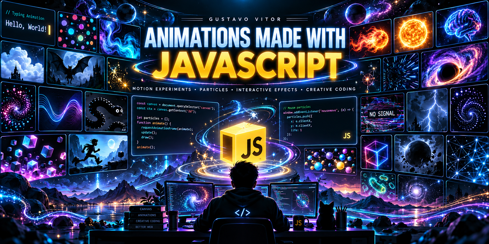

<div align="center">



<br>
<br>

# 🎞️ Animations Made with JavaScript

### Motion Experiments • Particles • Interactive Effects • Creative Coding

A professional collection of browser animations, visual experiments and interactive motion studies created with **HTML5**, **CSS3** and **Vanilla JavaScript**.

This repository works as a central hub for particle effects, mouse interactions, motion graphics, abstract simulations, space visuals, creature experiments and game-like animations — all published as independent projects with their own repositories and deploys.

<br>


<br>

**38 animation projects • Interactive motion • GitHub Pages collection**

</div>

---

## 🚀 Quick Access

| Project | Repository | Deploy |
|:--|:--:|:--:|
| **Typing Animation** | [Repository](https://github.com/GustavoVitorS/Typing-animation) | [Open Demo](https://gustavovitors.github.io/Typing-animation/) |
| **Polka Dots Animation** | [Repository](https://github.com/GustavoVitorS/Polka-dots-animation) | [Open Demo](https://gustavovitors.github.io/Polka-dots-animation/) |
| **Fluid Simulation JS** | [Repository](https://github.com/GustavoVitorS/Fluid-Simulation-JS) | [Open Demo](https://gustavovitors.github.io/Fluid-Simulation-JS/) |
| **Al Rata Alada** | [Repository](https://github.com/GustavoVitorS/al-rata-alada) | [Open Demo](https://gustavovitors.github.io/al-rata-alada/) |
| **Behind The Mouse** | [Repository](https://github.com/GustavoVitorS/Behind-The-Mouse) | [Open Demo](https://gustavovitors.github.io/Behind-The-Mouse/) |
| **Cloud Animation** | [Repository](https://github.com/GustavoVitorS/Cloud-Animation) | [Open Demo](https://gustavovitors.github.io/Cloud-Animation/) |
| **Simulation Purple Terminal** | [Repository](https://github.com/GustavoVitorS/Simulation-Purple-Terminal) | [Open Demo](https://gustavovitors.github.io/Simulation-Purple-Terminal/) |
| **Fireball** | [Repository](https://github.com/GustavoVitorS/Fireball) | [Open Demo](https://gustavovitors.github.io/Fireball/) |
| **Sun** | [Repository](https://github.com/GustavoVitorS/Sun) | [Open Demo](https://gustavovitors.github.io/Sun/) |
| **Brain of a Genius** | [Repository](https://github.com/GustavoVitorS/Brain-of-a-Genius) | [Open Demo](https://gustavovitors.github.io/Brain-of-a-Genius/) |
| **Particles JS Background** | [Repository](https://github.com/GustavoVitorS/Particles-JS_Background) | [Open Demo](https://gustavovitors.github.io/Particles-JS_Background/) |
| **Wave Lines** | [Repository](https://github.com/GustavoVitorS/Wave-lines) | [Open Demo](https://gustavovitors.github.io/Wave-lines/) |
| **Baby Black Snakes** | [Repository](https://github.com/GustavoVitorS/Baby-Black-Snakes) | [Open Demo](https://gustavovitors.github.io/Baby-Black-Snakes/) |
| **Rotating Particles** | [Repository](https://github.com/GustavoVitorS/Rotating-particles) | [Open Demo](https://gustavovitors.github.io/Rotating-particles/) |
| **Infinity Hypnotize** | [Repository](https://github.com/GustavoVitorS/Infinity-hypnotize) | [Open Demo](https://gustavovitors.github.io/Infinity-hypnotize/) |
| **Vertical Explosion** | [Repository](https://github.com/GustavoVitorS/vertical-explosion) | [Open Demo](https://gustavovitors.github.io/vertical-explosion/) |
| **Cubes and Gravity** | [Repository](https://github.com/GustavoVitorS/Cubes-and-Gravity) | [Open Demo](https://gustavovitors.github.io/Cubes-and-Gravity/) |
| **Blue JS Background** | [Repository](https://github.com/GustavoVitorS/Blue-JS-Background) | [Open Demo](https://gustavovitors.github.io/Blue-JS-Background/) |
| **Hyponitic Rotation** | [Repository](https://github.com/GustavoVitorS/Hyponitic_Rotation) | [Open Demo](https://gustavovitors.github.io/Hyponitic_Rotation/) |
| **Traveling Through Hyperspace V2** | [Repository](https://github.com/GustavoVitorS/Traveling-through-hyperspace-V2-JS) | [Open Demo](https://gustavovitors.github.io/Traveling-through-hyperspace-V2-JS/) |
| **Movement Space** | [Repository](https://github.com/GustavoVitorS/Movement-Space) | [Open Demo](https://gustavovitors.github.io/Movement-Space/) |
| **No Signal** | [Repository](https://github.com/GustavoVitorS/No_signal) | [Open Demo](https://gustavovitors.github.io/No_signal/) |
| **Storm** | [Repository](https://github.com/GustavoVitorS/Storm) | [Open Demo](https://gustavovitors.github.io/Storm/) |
| **Particle Spinning JS Animation** | [Repository](https://github.com/GustavoVitorS/Particle-Spinning-JS-Animation) | [Open Demo](https://gustavovitors.github.io/Particle-Spinning-JS-Animation/) |
| **Color Particles in Mouse JS** | [Repository](https://github.com/GustavoVitorS/Color-particles-in-mouse-JS) | [Open Demo](https://gustavovitors.github.io/Color-particles-in-mouse-JS/) |
| **Mouse Generated Particles** | [Repository](https://github.com/GustavoVitorS/Mouse-generated-particles) | [Open Demo](https://gustavovitors.github.io/Mouse-generated-particles/) |
| **JS Animation Circle** | [Repository](https://github.com/GustavoVitorS/js-animation-circle) | [Open Demo](https://gustavovitors.github.io/js-animation-circle/) |
| **Text JS** | [Repository](https://github.com/GustavoVitorS/Text-JS) | [Open Demo](https://gustavovitors.github.io/Text-JS/) |
| **Black Hole Devouring Stars** | [Repository](https://github.com/GustavoVitorS/Black-Hole-Devouring-Stars) | [Open Demo](https://gustavovitors.github.io/Black-Hole-Devouring-Stars/) |
| **Box RGB JS Animation** | [Repository](https://github.com/GustavoVitorS/Box-RGB-JS-Animation) | [Open Demo](https://gustavovitors.github.io/Box-RGB-JS-Animation/) |
| **Particles Colliding JS** | [Repository](https://github.com/GustavoVitorS/Particles_Colliding_Js) | [Open Demo](https://gustavovitors.github.io/Particles_Colliding_Js/) |
| **JS Infinite Runner** | [Repository](https://github.com/GustavoVitorS/JS_Infinite_Runner) | [Open Demo](https://gustavovitors.github.io/JS_Infinite_Runner/) |
| **JS Dark Sphere** | [Repository](https://github.com/GustavoVitorS/JS-Dark-Sphere) | [Open Demo](https://gustavovitors.github.io/JS-Dark-Sphere/) |
| **Bacteria Animation V2** | [Repository](https://github.com/GustavoVitorS/Bacteria-Animation-V2) | [Open Demo](https://gustavovitors.github.io/Bacteria-Animation-V2/) |
| **Falling into the Infinite Runner** | [Repository](https://github.com/GustavoVitorS/Falling-into-the-infinite-runner) | [Open Demo](https://gustavovitors.github.io/Falling-into-the-infinite-runner/) |
| **Bacteria Animation** | [Repository](https://github.com/GustavoVitorS/bacteria-animation) | [Open Demo](https://gustavovitors.github.io/bacteria-animation/) |
| **Stars Background** | [Repository](https://github.com/GustavoVitorS/Stars-Background) | [Open Demo](https://gustavovitors.github.io/Stars-Background/) |
| **Lines** | [Repository](https://github.com/GustavoVitorS/Lines) | [Open Demo](https://gustavovitors.github.io/Lines/) |

---

# 🖼️ Project Gallery

## ⌨️ Text & Interface Experiments

### Typing Animation

<div align="center">


<br><br>

[](https://github.com/GustavoVitorS/Typing-animation)
[](https://gustavovitors.github.io/Typing-animation/)

</div>

**Category:** Text / UI  
Typing effect and code-like text animation.

---

### Simulation Purple Terminal

<div align="center">


<br><br>

[](https://github.com/GustavoVitorS/Simulation-Purple-Terminal)
[](https://gustavovitors.github.io/Simulation-Purple-Terminal/)

</div>

**Category:** Text / UI  
A stylized terminal simulation with a purple identity.

---

### Text JS

<div align="center">


<br><br>

[](https://github.com/GustavoVitorS/Text-JS)
[](https://gustavovitors.github.io/Text-JS/)

</div>

**Category:** Text / Motion  
Text-based JavaScript animation or effect.

---

### No Signal

<div align="center">


<br><br>

[](https://github.com/GustavoVitorS/No_signal)
[](https://gustavovitors.github.io/No_signal/)

</div>

**Category:** Glitch / UI  
A no-signal glitch-inspired visual effect.

---

## ✨ Particles, Lines & Mouse Interaction

### Polka Dots Animation

<div align="center">


<br><br>

[](https://github.com/GustavoVitorS/Polka-dots-animation)
[](https://gustavovitors.github.io/Polka-dots-animation/)

</div>

**Category:** Particles / Patterns  
Animated dots and rhythmic pattern motion.

---

### Particles JS Background

<div align="center">


<br><br>

[](https://github.com/GustavoVitorS/Particles-JS_Background)
[](https://gustavovitors.github.io/Particles-JS_Background/)

</div>

**Category:** Particles / Background  
A JavaScript particles background effect.

---

### Particle Spinning JS Animation

<div align="center">


<br><br>

[](https://github.com/GustavoVitorS/Particle-Spinning-JS-Animation)
[](https://gustavovitors.github.io/Particle-Spinning-JS-Animation/)

</div>

**Category:** Particles / Motion  
Spinning particles with controlled circular movement.

---

### Color Particles in Mouse JS

<div align="center">


<br><br>

[](https://github.com/GustavoVitorS/Color-particles-in-mouse-JS)
[](https://gustavovitors.github.io/Color-particles-in-mouse-JS/)

</div>

**Category:** Mouse / Particles  
Particles generated or influenced by mouse movement.

---

### Mouse Generated Particles

<div align="center">


<br><br>

[](https://github.com/GustavoVitorS/Mouse-generated-particles)
[](https://gustavovitors.github.io/Mouse-generated-particles/)

</div>

**Category:** Mouse / Particles  
A pointer-reactive particle generator.

---

### Particles Colliding JS

<div align="center">


<br><br>

[](https://github.com/GustavoVitorS/Particles_Colliding_Js)
[](https://gustavovitors.github.io/Particles_Colliding_Js/)

</div>

**Category:** Particles / Physics  
Particles interacting through collision behavior.

---

### Rotating Particles

<div align="center">


<br><br>

[](https://github.com/GustavoVitorS/Rotating-particles)
[](https://gustavovitors.github.io/Rotating-particles/)

</div>

**Category:** Particles / Motion  
Particles rotating in organized or hypnotic movement.

---

### JS Animation Circle

<div align="center">


<br><br>

[](https://github.com/GustavoVitorS/js-animation-circle)
[](https://gustavovitors.github.io/js-animation-circle/)

</div>

**Category:** Geometry / Motion  
A circular motion experiment built with JavaScript.

---

### Wave Lines

<div align="center">


<br><br>

[](https://github.com/GustavoVitorS/Wave-lines)
[](https://gustavovitors.github.io/Wave-lines/)

</div>

**Category:** Lines / Motion  
Flowing wave-like line animation.

---

### Lines

<div align="center">


<br><br>

[](https://github.com/GustavoVitorS/Lines)
[](https://gustavovitors.github.io/Lines/)

</div>

**Category:** Lines / Motion  
A clean line-based motion experiment.

---

### Behind The Mouse

<div align="center">


<br><br>

[](https://github.com/GustavoVitorS/Behind-The-Mouse)
[](https://gustavovitors.github.io/Behind-The-Mouse/)

</div>

**Category:** Interaction  
Interactive movement following or reacting to the pointer.

---

## 🌌 Space, Energy & Atmosphere

### Fluid Simulation JS

<div align="center">


<br><br>

[](https://github.com/GustavoVitorS/Fluid-Simulation-JS)
[](https://gustavovitors.github.io/Fluid-Simulation-JS/)

</div>

**Category:** Simulation  
Fluid-like motion and dynamic visual flow.

---

### Fireball

<div align="center">


<br><br>

[](https://github.com/GustavoVitorS/Fireball)
[](https://gustavovitors.github.io/Fireball/)

</div>

**Category:** Energy  
A fiery animated object with motion and glow.

---

### Sun

<div align="center">


<br><br>

[](https://github.com/GustavoVitorS/Sun)
[](https://gustavovitors.github.io/Sun/)

</div>

**Category:** Cosmic  
A stylized animated sun with warmth and light effects.

---

### Black Hole Devouring Stars

<div align="center">


<br><br>

[](https://github.com/GustavoVitorS/Black-Hole-Devouring-Stars)
[](https://gustavovitors.github.io/Black-Hole-Devouring-Stars/)

</div>

**Category:** Space / Cosmic  
A cosmic animation centered on a black hole consuming stars.

---

### Traveling Through Hyperspace V2

<div align="center">


<br><br>

[](https://github.com/GustavoVitorS/Traveling-through-hyperspace-V2-JS)
[](https://gustavovitors.github.io/Traveling-through-hyperspace-V2-JS/)

</div>

**Category:** Space / Motion  
A high-speed hyperspace travel effect.

---

### Movement Space

<div align="center">


<br><br>

[](https://github.com/GustavoVitorS/Movement-Space)
[](https://gustavovitors.github.io/Movement-Space/)

</div>

**Category:** Space / Motion  
Motion-based spatial animation.

---

### JS Dark Sphere

<div align="center">


<br><br>

[](https://github.com/GustavoVitorS/JS-Dark-Sphere)
[](https://gustavovitors.github.io/JS-Dark-Sphere/)

</div>

**Category:** Sphere / Atmosphere  
A dark sphere animation with depth and mood.

---

### Blue JS Background

<div align="center">


<br><br>

[](https://github.com/GustavoVitorS/Blue-JS-Background)
[](https://gustavovitors.github.io/Blue-JS-Background/)

</div>

**Category:** Background / Atmosphere  
A blue-toned animated background built with JavaScript.

---

### Infinity Hypnotize

<div align="center">


<br><br>

[](https://github.com/GustavoVitorS/Infinity-hypnotize)
[](https://gustavovitors.github.io/Infinity-hypnotize/)

</div>

**Category:** Hypnotic / Loop  
An infinity-style looping visual animation.

---

### Hyponitic Rotation

<div align="center">


<br><br>

[](https://github.com/GustavoVitorS/Hyponitic_Rotation)
[](https://gustavovitors.github.io/Hyponitic_Rotation/)

</div>

**Category:** Hypnotic / Rotation  
A rotating visual experiment with hypnotic motion.

---

### Cloud Animation

<div align="center">


<br><br>

[](https://github.com/GustavoVitorS/Cloud-Animation)
[](https://gustavovitors.github.io/Cloud-Animation/)

</div>

**Category:** Atmosphere  
Animated cloud movement and sky ambience.

---

### Storm

<div align="center">


<br><br>

[](https://github.com/GustavoVitorS/Storm)
[](https://gustavovitors.github.io/Storm/)

</div>

**Category:** Weather / Atmosphere  
A storm-themed animation with atmosphere and energy.

---

### Stars Background

<div align="center">


<br><br>

[](https://github.com/GustavoVitorS/Stars-Background)
[](https://gustavovitors.github.io/Stars-Background/)

</div>

**Category:** Space / Background  
A star-field background animation.

---

### Brain of a Genius

<div align="center">


<br><br>

[](https://github.com/GustavoVitorS/Brain-of-a-Genius)
[](https://gustavovitors.github.io/Brain-of-a-Genius/)

</div>

**Category:** Concept / Abstract  
A symbolic animated concept piece centered on intelligence and energy.

---

### Vertical Explosion

<div align="center">


<br><br>

[](https://github.com/GustavoVitorS/vertical-explosion)
[](https://gustavovitors.github.io/vertical-explosion/)

</div>

**Category:** Explosion / Motion  
A vertical burst or explosion effect.

---

## 🧬 Organic, Character & Game Motion

### Al Rata Alada

<div align="center">


<br><br>

[](https://github.com/GustavoVitorS/al-rata-alada)
[](https://gustavovitors.github.io/al-rata-alada/)

</div>

**Category:** Creature / Art  
A character-based visual experiment with motion.

---

### Baby Black Snakes

<div align="center">


<br><br>

[](https://github.com/GustavoVitorS/Baby-Black-Snakes)
[](https://gustavovitors.github.io/Baby-Black-Snakes/)

</div>

**Category:** Creature / Motion  
A playful creature-based animation with snake motion.

---

### Bacteria Animation V2

<div align="center">


<br><br>

[](https://github.com/GustavoVitorS/Bacteria-Animation-V2)
[](https://gustavovitors.github.io/Bacteria-Animation-V2/)

</div>

**Category:** Organic / Motion  
An evolved bacteria-inspired animation.

---

### Bacteria Animation

<div align="center">


<br><br>

[](https://github.com/GustavoVitorS/bacteria-animation)
[](https://gustavovitors.github.io/bacteria-animation/)

</div>

**Category:** Organic / Motion  
An earlier bacteria-themed motion experiment.

---

### JS Infinite Runner

<div align="center">


<br><br>

[](https://github.com/GustavoVitorS/JS_Infinite_Runner)
[](https://gustavovitors.github.io/JS_Infinite_Runner/)

</div>

**Category:** Game / Motion  
An endless runner animation or playable experiment.

---

### Falling into the Infinite Runner

<div align="center">


<br><br>

[](https://github.com/GustavoVitorS/Falling-into-the-infinite-runner)
[](https://gustavovitors.github.io/Falling-into-the-infinite-runner/)

</div>

**Category:** Game / Motion  
A motion experiment inspired by falling movement and runner aesthetics.

---

### Cubes and Gravity

<div align="center">


<br><br>

[](https://github.com/GustavoVitorS/Cubes-and-Gravity)
[](https://gustavovitors.github.io/Cubes-and-Gravity/)

</div>

**Category:** Physics / Motion  
A gravity-based animation involving cubes.

---

### Box RGB JS Animation

<div align="center">


<br><br>

[](https://github.com/GustavoVitorS/Box-RGB-JS-Animation)
[](https://gustavovitors.github.io/Box-RGB-JS-Animation/)

</div>

**Category:** RGB / Glow  
A box animation using RGB lighting or glow effects.

---

# 🧠 Collection Focus

This collection documents different front-end animation directions built with JavaScript, including:

- particle systems;
- mouse interaction;
- motion graphics;
- animated backgrounds;
- text effects;
- glitch and terminal aesthetics;
- simulations and abstract systems;
- game-inspired motion;
- cosmic, weather and energy visuals.

The goal is not to force all projects into one style, but to show the breadth of animation work possible in the browser with lightweight front-end technology.

---

## 🛠️ Main Technologies

<div align="center">

| Technology | Usage |
|:--:|:--|
| **HTML5** | Structure, canvas containers and UI scaffolding |
| **CSS3** | Styling, layout, glow, gradients and responsive presentation |
| **Vanilla JavaScript** | Animation logic, interaction and rendering behavior |
| **Canvas 2D** | Real-time drawing and visual effects |
| **requestAnimationFrame** | Smooth browser-synced motion |
| **Pointer Events** | Mouse and touch input for interactive effects |
| **GitHub Pages** | Static deployment for every project |

</div>

---

## 📁 Repository Structure

All files can be uploaded directly to the repository root.

```text
Animations-made-with-javascript/
├── README.md
├── animations-made-with-javascript-banner.png
├── typing-animation-preview.png
├── polka-dots-animation-preview.png
├── fluid-simulation-js-preview.png
├── al-rata-alada-preview.png
├── behind-the-mouse-preview.png
├── cloud-animation-preview.png
├── simulation-purple-terminal-preview.png
├── fireball-preview.png
├── sun-preview.png
├── brain-of-a-genius-preview.png
├── particles-js-background-preview.png
├── wave-lines-preview.png
├── baby-black-snakes-preview.png
├── rotating-particles-preview.png
├── infinity-hypnotize-preview.png
├── vertical-explosion-preview.png
├── cubes-and-gravity-preview.png
├── blue-js-background-preview.png
├── hyponitic-rotation-preview.png
├── traveling-through-hyperspace-v2-js-preview.png
├── movement-space-preview.png
├── no-signal-preview.png
├── storm-preview.png
├── particle-spinning-js-animation-preview.png
├── color-particles-in-mouse-js-preview.png
├── mouse-generated-particles-preview.png
├── js-animation-circle-preview.png
├── text-js-preview.png
├── black-hole-devouring-stars-preview.png
├── box-rgb-js-animation-preview.png
├── particles-colliding-js-preview.png
├── js-infinite-runner-preview.png
├── js-dark-sphere-preview.png
├── bacteria-animation-v2-preview.png
├── falling-into-the-infinite-runner-preview.png
├── bacteria-animation-preview.png
├── stars-background-preview.png
├── lines-preview.png
```

---

## 🖼️ About the Preview Images

The preview images included in this hub are collection assets created to visually identify each project inside the repository.

If you want to replace any preview later with a **real screenshot of the latest deployed version**, simply keep the same filename and upload the new image to the repository root. The README will continue to work without any further edits.

---

## 🌐 About This Repository

**Animations Made with JavaScript** is a central portfolio index for my animation and creative-coding projects.

Each project keeps its own:

- source repository;
- independent history;
- visual identity;
- live GitHub Pages deployment.

This repository exists to organize them all in one professional and easy-to-browse collection.

---

<div align="center">

## 👨‍💻 Gustavo Vitor

**JavaScript Animations • Creative Coding • Interactive Motion • Front-End Experiments**

<br>

[](https://github.com/GustavoVitorS)

<br>

### Animate • Experiment • Build • Evolve

</div>
